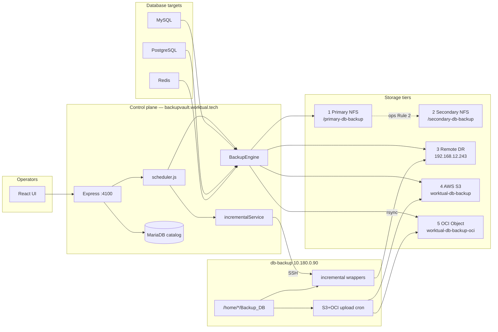
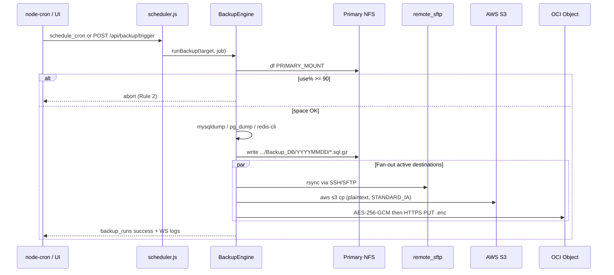
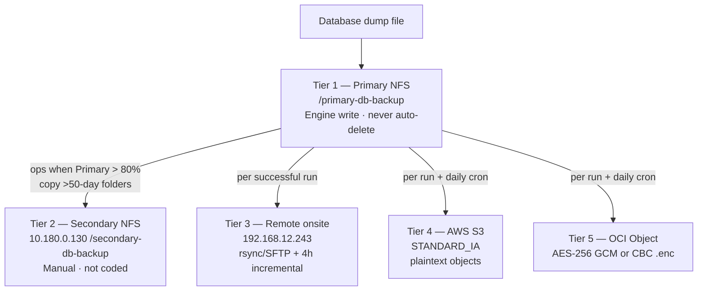
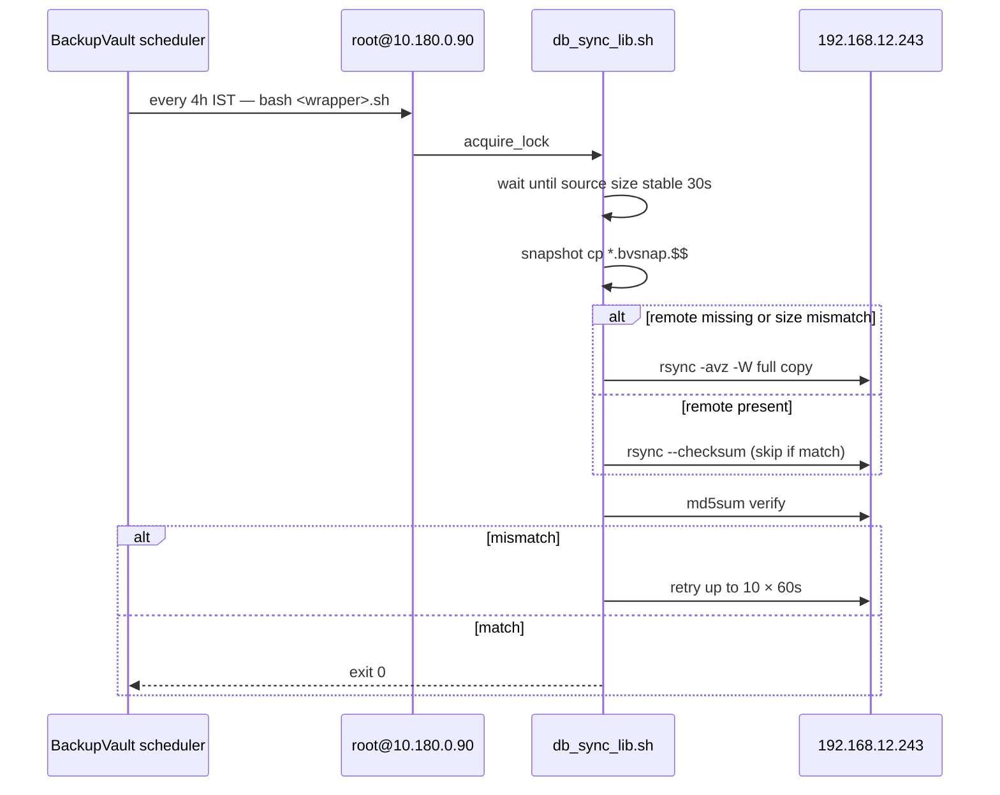
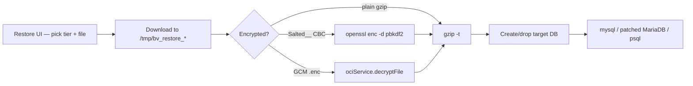

# BackupVault — Architecture and Call-Flow Design

Worktual BackupVault is the control plane for database dumps, NFS landing zones, on-prem DR, and cloud object copies. This document describes **what is actually built** in the product (React + Express at `https://backupvault.worktual.tech`), plus the companion dump/upload host `10.180.0.90`.

Related interactive view (Cursor canvas): architecture, database backup, storage tiers, incremental, restore.

---

## 1. What we built

| Capability | Implementation |
|------------|----------------|
| Control plane | React 18 UI + Express API on port **4100** (PM2 `backupvault`), JWT auth, roles `super_admin` → `viewer` |
| Catalog | MariaDB `backupvault` on localhost — targets, jobs, runs, destinations, NFS snapshots, activity |
| Full dumps | `BackupEngine.runDump()` — MySQL `mysqldump \| gzip`, PostgreSQL `pg_dump -Fc`, Redis `redis-cli --rdb` |
| Five storage tiers | Primary NFS, Secondary NFS, Remote onsite DR, AWS S3, OCI Object Storage |
| Incremental | SSH every 4 hours to `root@10.180.0.90`, snapshot + rsync to `192.168.12.243` |
| NFS health | Live `df` every 60s; 80% email; **90% blocks new dumps**; Primary **never auto-deleted** |
| Cloud | Engine fan-out after each dump; companion daily S3+OCI cron on the dump host |
| Restore | Pull from any tier; auto-detect OCI AES-256-GCM vs legacy CBC |
| Query / Reports | Isolated APIs with `QUERY_ENCRYPTION_KEY`; JSON report definitions |

**Cloud retention (live):** Daily job keeps the last **30 days** of backup objects on active AWS S3 and OCI destinations and deletes older `Backup_DB` / dump files (`CLOUD_RETENTION_*` in `.env`). Primary NFS is not auto-deleted.

**Not automated in code (Strategy UI still describes them):** Primary→Secondary copy, S3 Glacier after 90 days, per-job `retention_days` on NFS.

---

## 2. Architecture diagram



### Hosts

| Role | Address / path |
|------|----------------|
| App | `/var/www/backupvault` · public `backupvault.worktual.tech` |
| Catalog | `localhost:3306` database `backupvault` |
| Primary NFS | `PRIMARY_MOUNT=/primary-db-backup` |
| Secondary NFS | `SECONDARY_MOUNT=/secondary-db-backup` (UI also cites `10.180.0.130`) |
| Dump / incremental | `INCREMENTAL_SSH_HOST=10.180.0.90` user `root` |
| Remote DR | `REMOTE_DR_HOST=192.168.12.243` |
| AWS | Bucket `worktual-db-backup` (engine + CLI) |
| OCI | Bucket `worktual-db-backup-oci`, region `ap-mumbai-1` |

---

## 3. Database backup diagram



### Dump landing path

```
/primary-db-backup/<database_name>/Backup_DB/<YYYYMMDD>/<db_type>_<db>_<type>_<date>_<time>.sql.gz
```

MySQL uses `--single-transaction --quick --routines --triggers --events` then `gzip -1` and `gzip -t`. PostgreSQL uses custom format (`.dump`). Redis writes an RDB snapshot.

### Call flow (Rule 1 + Rule 4)

1. **Trigger** — `backup_jobs.schedule_cron` (UI default copy: daily 03:00 IST) or Dashboard on-demand `POST /api/backup/trigger` / `trigger-all`.
2. **Gate** — `df` on Primary. ≥90% throws; 80% is alert-only (`STORAGE_WARN_PCT` / `STORAGE_CRIT_PCT`).
3. **Dump** — `backupEngine.js` `runDump()`.
4. **Skip local dests** — NFS/local destinations are already the write path.
5. **Fan-out** — every `backup_destinations` row with `is_active=1`:
   - `remote_sftp` / `remote` → `remoteSync.rsyncFileToRemote` (typically `/backups/remote/<db>/Backup_DB/<date>/`)
   - `aws_s3` → `s3Service.uploadToS3` (no client-side encryption)
   - `oci_object` → `ociService.uploadToOCI` (GCM if `encryption_enabled` and `BACKUP_ENCRYPTION_KEY` is 32-byte hex)

Live logs: `backup_logs` + WebSocket `wsManager`.

---

## 4. File storage diagram (five tiers)



| Tier | Writer | Auto-delete | Notes |
|------|--------|-------------|-------|
| 1 Primary | Engine | **No** (`AUTO_CLEANUP=false`; `storageMonitor` skips delete) | 90% blocks new dumps |
| 2 Secondary | Operators | No | Strategy Rule 2; no backend copy job |
| 3 Remote DR | Engine rsync + incremental | No retention job | Incremental uses `/home/worktual/<db>/` |
| 4 S3 | Engine + `10.180.0.90` cron | **Keep 30 days** — daily `cloudRetention` purge | Browser: `/s3-storage` |
| 5 OCI | Engine GCM + dump-host cron | **Keep 30 days** — same purge job | Browser: `/oci-storage` (folder last-modified via `/api/oci/:id/folder-stats`) |

### Companion cloud cron (dump host)

Daily dumps under `/home/<db>/Backup_DB/` on `10.180.0.90` are uploaded by `/usr/local/src/aws-cli-setup/db-backup-upload-aws-oci.sh` (cron `0 5 * * *`). That script is **ops on the dump host**, not this git tree. S3 is plaintext; OCI is AES-256-CBC (`Salted__`) compatible with BackupVault restore. AWS CLI v2 against OCI needs `AWS_REQUEST_CHECKSUM_CALCULATION=when_required`.

---

## 5. Incremental backup call flow



Jobs: `ccaas`, `ccaas_ai`, `ai_worktual_crm`, `unifiedring`, `marketing_automation`, `audracare`, `whatsappcampaign`.

APIs: `GET /api/incremental/jobs`, `GET /api/incremental/jobs/:id/log`, `POST .../run`, `POST .../run-all`.

NFS monitoring is independent: `nfs_servers` + `checkAllLive` every 60s → `nfs_monitoring_snapshots`.

---

## 6. Restore call flow



Tiers in UI: primary, secondary, remote, s3, oci. Restore job state is **in-memory** (not a catalog table).

---

## 7. Control-plane scheduler

| Interval | Task |
|----------|------|
| `backup_jobs.schedule_cron` | Full dump + fan-out |
| `0 */4 * * *` Asia/Kolkata | Incremental SSH cycle |
| `30 6 * * *` Asia/Kolkata | Cloud retention — keep 30d on S3 + OCI, purge older dumps |
| 60s | NFS live stats |
| 5 min | DB server metrics (SSH) |
| 15 min | S3 + remote connectivity |
| 30 min | Storage threshold emails |
| 09:00 IST | Daily summary email |

---

## 8. Product map (what the UI is for)

| Page | Purpose |
|------|---------|
| Dashboard | Tier health, Rule badges, recent Primary files |
| Strategy | Human-readable Rules 1–6 (includes some process-only items) |
| Targets / Jobs | Database endpoints and schedules |
| Storage / NFS | Browse Primary/Secondary, mount health |
| Incremental Backup | 4h jobs, logs, run |
| S3 Storage / OCI Storage | Object browsers |
| Restore | Reload a dump into a target |
| Query / Reports | Ad-hoc SQL and scheduled CSV/email reports (not on the dump path) |

---

## 9. Key source files

- `backend/src/services/backupEngine.js` — dump + fan-out
- `backend/src/services/scheduler.js` — all timers
- `backend/src/services/incrementalService.js` — SSH to 10.180.0.90
- `backend/src/services/ociService.js` / `s3Service.js` / `remoteSync.js` / `storageMonitor.js`
- `backend/src/routes/api.js` — backup, restore, OCI list/folder-stats
- `scripts_for_incremental_backup/db_sync_lib.sh` — snapshot + rsync
- `frontend/src/pages/BackupStrategy.js`, `Dashboard.js`, `IncrementalBackup.js`, `OCIBrowser.js`, `RestoreDB.js`
- `deploy.sh` — `/var/www/backupvault`

---

*Generated from the BackupVault codebase as of September 2026. Treat Strategy-page Glacier/auto-Secondary copy as runbook, not as implemented jobs.*
